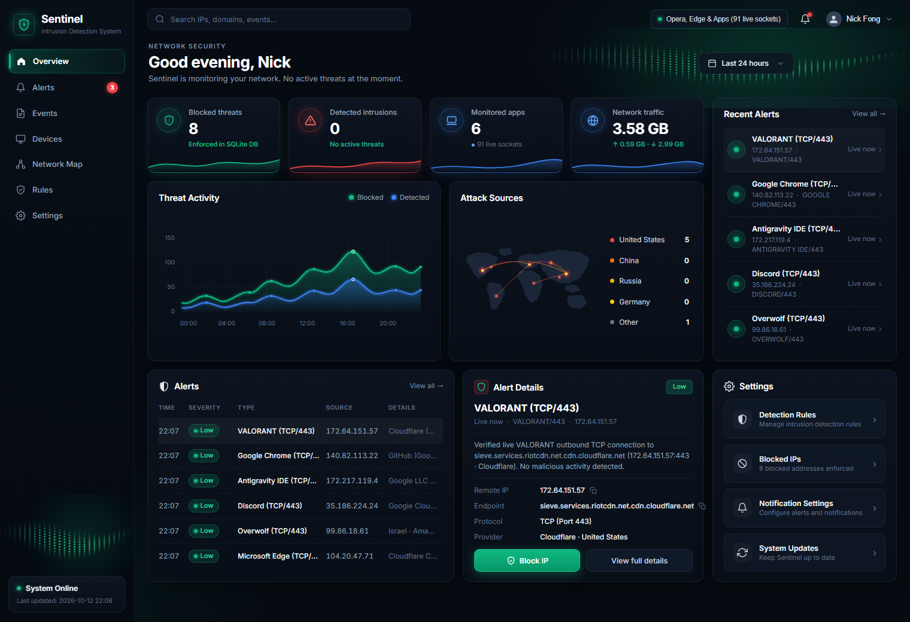

# sentinel

autonomous desktop network & privacy intrusion detection system powered by nvidia nemotron and nebius token factory.



---

## overview

sentinel monitors active applications and outbound network connections on your computer in real time. it pairs a local socket & process telemetry engine with **nvidia nemotron (`nvidia/Llama-3.1-Nemotron-70B-Instruct-HF`)** hosted on **nebius token factory** to inspect live traffic, identify trackers, and classify endpoints by country of origin without breaking your active apps or games.

### features

- **live open-window socket monitoring**: tracks real `established` tcp/udp sockets via `psutil`, local windows dns cache (`ipconfig /displaydns`), and win32 desktop window visibility (`winsta0\default`) so only genuinely open apps are shown.
- **4-tier country classification**: accurately maps running applications and remote endpoints (`united states`, `china`, `russia`, `germany`, and `other`) using:
  1. curated application publisher origin database
  2. windows pe authenticode x.509 certificate country extraction (`oid 2.5.4.6`)
  3. domain tld and cloud asn prefix matching
  4. regional internet registry (arin / apnic / ripe) ipv4 blocks
- **nvidia nemotron deep packet investigation**: explains in plain english what an endpoint does, its risk level, and what happens if you block it.
- **ai autopilot & protect me sweep**: automatically flags and blocks high-confidence trackers while preserving essential apis and cdns.
- **persistent sqlite policy store**: 1-click block/unblock toggle stored locally in `sentinel_data.db`.
- **dynamic operator profile**: automatically detects and greets the active windows user profile.

---

## usage

```bash
pip install -r requirements.txt
python main.py --live --web-only
```

---

## project structure

```text
sentinel/
├── backend/              # fastapi server, routes & config
├── monitor/              # live socket monitor, win32 window filter & country classifier
├── privacy_engine/       # tracker blocklist, heuristics & pii sanitizer
├── agent/                # nvidia nemotron client & offline fallback engine
├── database/             # sqlite policy store
├── frontend/             # dashboard html, css & live js controller
├── browser_extension/    # companion browser telemetry extension
├── tests/                # pytest test suite (34 tests)
└── main.py               # cli & server entrypoint
```

---

## license

mit license. see [license](LICENSE) for details.
